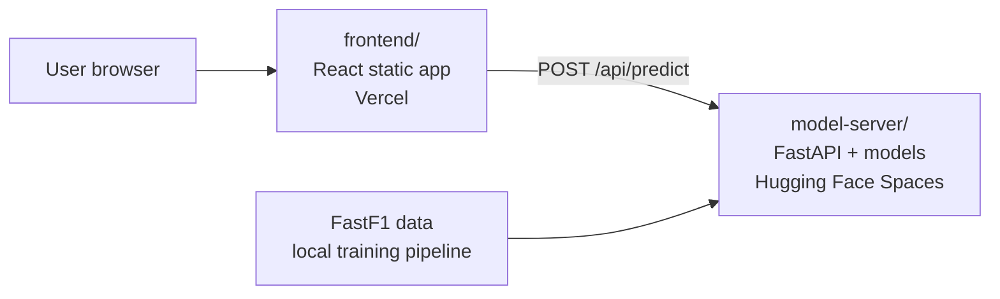

# Driver Profiler

Driver Profiler is the driver-analysis application in the F1 Analytics
Platform. It uses real [FastF1](https://docs.fastf1.dev/) race data to
estimate sector times, score lap consistency, classify driving style, compare
telemetry with the field, and show the most influential input features.

The project uses a split deployment because the trained model bundle and
TensorFlow dependency are too large for a Vercel serverless function:



- **`frontend/`** is a React application. It is responsible for the
  selectors, result cards, charts, theme, and explainability display.
- **`model-server/`** is a FastAPI application. It loads the selected
  production models and exposes the prediction API on port `7860`.
- **`model-server/training/`** contains the data collection, feature
  engineering, model training, and evaluation pipeline.
- **`data/`**, `model-server/models/`, and `evaluation_report/` contain
  generated artifacts and are mostly gitignored.

## Features and models

| Capability | Prediction | Candidate models |
|---|---|---|
| Sector breakdown | Sector 1, 2, and 3 time in seconds | Linear Regression, XGBoost, Random Forest; optional LSTM for sequence targets |
| Consistency | Rolling lap-time standard deviation and rating | Linear Regression, XGBoost, optional LSTM |
| Driving style | Aggressive, conservative, flowing, or balanced | Logistic Regression, XGBoost, Random Forest |
| Telemetry delta | Seconds faster or slower than the field average | Linear Regression, XGBoost, Random Forest |
| Explainability | Top feature contributions for supported models | SHAP for tree-based models |

LSTM models use five-lap sequences. TensorFlow is optional in the Python
code: if it is unavailable, LSTM training and inference are skipped and the
non-LSTM candidates continue to work. The checked-in requirements file
includes `tensorflow-cpu` for the full pipeline.

## Prerequisites

Install the following before starting:

- Python 3.11
- Node.js 18 or newer and npm
- Git, if cloning the project
- Enough disk space for FastF1's cache, generated data, and model artifacts

On Windows, PowerShell commands can be run from the repository root:

```powershell
cd C:\path\to\driver-profiler
```

## Repository layout

```text
driver-profiler/
├── data/
│   ├── cache/                       # FastF1 HTTP cache
│   ├── raw/                        # collected CSV and progress checkpoint
│   └── processed/                  # engineered CSV and LSTM sequences
├── evaluation_report/              # metrics JSON and SHAP plots
├── model-server/
│   ├── app.py                      # FastAPI application
│   ├── utils.py                    # request-to-feature-vector conversion
│   ├── requirements.txt             # Python dependencies
│   ├── Dockerfile                   # Hugging Face Spaces image
│   ├── models/
│   │   ├── production/              # promoted models used by the API
│   │   └── ...                      # intermediate models and metadata
│   └── training/
│       ├── circuits_config.json
│       ├── collect_data.py
│       ├── engineer_features.py
│       ├── train_models.py
│       └── evaluate_models.py
└── frontend/
    ├── src/
    ├── public/
    ├── package.json
    └── vercel.json
```

## Quick start: run the application locally

The frontend and model server run as two processes. Start the model server
first, then start the React development server.

### 1. Create the Python environment

```powershell
cd model-server
py -3.11 -m venv .venv
.\.venv\Scripts\Activate.ps1
python -m pip install --upgrade pip
pip install -r requirements.txt
```

If PowerShell blocks activation, either enable script execution for the
current user or run the environment's Python executable directly:

```powershell
Set-ExecutionPolicy -Scope CurrentUser RemoteSigned
```

### 2. Start the model server

From `model-server/`:

```powershell
uvicorn app:app --reload --host 0.0.0.0 --port 7860
```

Verify that the service is reachable:

```powershell
Invoke-RestMethod http://localhost:7860/
```

The API loads models on the first prediction request. The repository must
contain trained model artifacts under `model-server/models/` for real model
predictions. If those artifacts are not present, the API will not have the
production models required for inference.

### 3. Start the frontend

Open a second terminal:

```powershell
cd C:\path\to\driver-profiler\frontend
npm install
npm start
```

The React development server normally opens at
`http://localhost:3000`. The `proxy` setting in `frontend/package.json`
forwards `/api` requests to `http://localhost:7860`, so no frontend source
change is needed for local development.

When the model server cannot be reached, the UI intentionally falls back to a
deterministic local demo heuristic and labels the result as demo mode. This
keeps the interface usable while the backend is starting or deployed
remotely, but those results are not model predictions.

## Build the frontend

To create the production static bundle:

```powershell
cd frontend
npm run build
```

The output is written to `frontend/build/`. Run the existing checks with:

```powershell
npm test
```

## Train the models

The training pipeline is resumable and should be run from
`model-server/training/` in this order:

```powershell
cd C:\path\to\driver-profiler\model-server\training

python collect_data.py
python engineer_features.py
python train_models.py
python evaluate_models.py
```

### Pipeline stages

1. **`collect_data.py`** downloads Race-session lap, sector, and summary
   telemetry data through FastF1. It writes rows incrementally to
   `data/raw/driver_profiler_data.csv`.
2. **`engineer_features.py`** creates encoded categorical features, rolling
   consistency features, driving-style clusters, and five-lap sequences. It
   writes the flattened feature table to
   `data/processed/driver_profiler_features.csv` and sequences to
   `data/processed/sequences.npz`.
3. **`train_models.py`** trains the candidate models and stores intermediate
   models, scalers, metadata, encoders, and test splits under
   `model-server/models/`.
4. **`evaluate_models.py`** compares candidates, writes metrics and SHAP
   plots to `evaluation_report/`, and promotes the best model for each
   predictor to `model-server/models/production/`.

### Resuming or restarting collection

Collection saves a checkpoint at `data/raw/progress.json`. If a run stops,
run the same command again; completed sessions are skipped and failed
sessions are retried:

```powershell
python collect_data.py
```

To ignore the checkpoint and start collection over:

```powershell
python collect_data.py --fresh
```

The collector covers the seasons and races configured in
`model-server/training/collect_data.py`. Update that file or
`circuits_config.json` when changing the supported training data.

## Model server API

### Health check

```http
GET /
```

The response includes service information and the available circuits and
drivers derived from the model metadata.

### Prediction

```http
POST /api/predict
Content-Type: application/json
```

Example request:

```json
{
  "circuit": "Silverstone",
  "compound": "MEDIUM",
  "driver": "VER",
  "tyre_life": 12,
  "avg_speed": 215,
  "max_speed": 320,
  "avg_throttle_pct": 72,
  "brake_pct": 14,
  "recent_avg_lap_s": 88,
  "recent_std_s": 0.2,
  "lap_history": null
}
```

Request fields:

| Field | Type | Description |
|---|---|---|
| `circuit` | string | Circuit name used by the feature encoder |
| `compound` | string | Tyre compound, for example `SOFT`, `MEDIUM`, or `HARD` |
| `driver` | string | Driver abbreviation, for example `VER` |
| `tyre_life` | number | Current tyre age in laps |
| `avg_speed` | number | Average speed for the input lap or stint |
| `max_speed` | number | Maximum speed |
| `avg_throttle_pct` | number | Average throttle percentage |
| `brake_pct` | number | Braking percentage |
| `recent_avg_lap_s` | number | Recent average lap time in seconds |
| `recent_std_s` | number | Recent lap-time standard deviation |
| `lap_history` | array or `null` | Optional five-lap sequence for LSTM-backed models |

Each `lap_history` row is:

```text
[lap_time, sector1, sector2, sector3, avg_speed, throttle, brake, tyre_life]
```

If the promoted model for sector 1 or consistency is an LSTM and a valid
five-lap history is supplied, the API can use the sequence model. Otherwise,
it uses the flattened feature representation.

Example PowerShell request:

```powershell
$body = @{
  circuit = "Silverstone"
  compound = "MEDIUM"
  driver = "VER"
  tyre_life = 12
  avg_speed = 215
  max_speed = 320
  avg_throttle_pct = 72
  brake_pct = 14
  recent_avg_lap_s = 88
  recent_std_s = 0.2
  lap_history = $null
} | ConvertTo-Json

Invoke-RestMethod `
  -Uri http://localhost:7860/api/predict `
  -Method Post `
  -ContentType "application/json" `
  -Body $body
```

The response contains `success`, the normalized `input`, `predictions`,
`model_sources`, and SHAP factors when explainers are available. The
frontend reads sector predictions, estimated lap time, consistency,
driving-style, telemetry delta, and explainability factors from this
response.

## Deploy the model server to Hugging Face Spaces

The model server is packaged for a Docker-based Hugging Face Space:

1. Create a new Hugging Face Space and select **Docker** as the SDK.
2. Copy or push the contents of `model-server/` into the Space repository.
3. Ensure the trained artifacts required for inference are included in the
   Space, especially `models/production/`, `models/model_metadata.json`, and
   `models/label_encoders.pkl`.
4. Let the Space build the `Dockerfile`.
5. Confirm the service is available at port `7860` and test its public
   health-check URL.

The Docker image installs the pinned Python dependencies, copies the model
server, and starts:

```text
uvicorn app:app --host 0.0.0.0 --port 7860
```

The Space metadata in `model-server/README.md` declares the same port for
Hugging Face's Docker runtime.

## Deploy the frontend to Vercel

Before deploying, edit `frontend/vercel.json` and replace the placeholder
destination:

```json
{
  "rewrites": [
    {
      "source": "/api/:path*",
      "destination": "https://YOUR-HF-USERNAME-driver-profiler.hf.space/api/:path*"
    }
  ]
}
```

Then deploy:

```powershell
cd frontend
npx vercel --prod
```

The rewrite makes browser requests to `/api/predict` reach the deployed
FastAPI service without changing the React application code. For local
development, the `proxy` in `package.json` is used instead.

## Common issues

### The frontend shows demo mode

Confirm that the model server is running on port `7860`, then check
`http://localhost:7860/`. For a deployed frontend, confirm that the
destination in `frontend/vercel.json` is the exact public Hugging Face URL
and that the Space has finished building.

### The API starts but predictions fail

Check that model artifacts exist under `model-server/models/` and that the
production directory contains the files promoted by
`evaluate_models.py`. Re-run the complete training pipeline if the data or
metadata is missing.

### Collection is slow or stops on a race

FastF1 downloads and parses telemetry data, so the first collection can take
significant time. The collector uses a cache, a per-session timeout, and a
checkpoint. Re-run `python collect_data.py` to resume; failed sessions are
recorded for retry.

### TensorFlow or LSTM is unavailable

Install the dependencies from `model-server/requirements.txt` for the full
pipeline. If TensorFlow cannot be installed on a particular machine, the
training and evaluation code can skip LSTM candidates and continue with the
linear, XGBoost, and Random Forest candidates.

## Development notes

- Do not commit generated raw data, caches, model binaries, or evaluation
  plots unless the deployment process specifically requires them.
- Keep `circuits_config.json`, model metadata, encoders, and promoted
  production models synchronized. The API uses these artifacts to convert
  frontend inputs into the feature vectors expected by the models.
- Run feature engineering again whenever the raw-data schema or feature
  definitions change.
- Run evaluation after training so `SELECTED_MODELS.json` and the production
  directory reflect the best candidate models.
